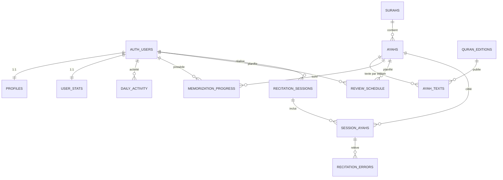

# Base de données Supabase

Le dossier `supabase/` contient quatre migrations, appliquées dans l'ordre des
noms :

| Ordre | Migration                                                                                             | Rôle                                                                                            |
| ----- | ----------------------------------------------------------------------------------------------------- | ----------------------------------------------------------------------------------------------- |
| 1     | [`20261015200000_progress_sync.sql`](migrations/20261015200000_progress_sync.sql)                     | Tables de synchronisation historiques : `user_progress`, `verse_mastery`, `daily_activity`.     |
| 2     | [`20261029090000_normalized_quran_schema.sql`](migrations/20261029090000_normalized_quran_schema.sql) | Modèle normalisé : profil, statistiques, texte coranique, progression, sessions et erreurs.     |
| 3     | [`20261029100000_drop_legacy_progress.sql`](migrations/20261029100000_drop_legacy_progress.sql)       | Bascule finale : reprend les JSON historiques puis supprime `user_progress` et `verse_mastery`. |
| 4     | [`20261029110000_cap_review_schedule.sql`](migrations/20261029110000_cap_review_schedule.sql)         | Réparation des échéances SM-2 aberrantes : intervalle ≤ 365 j, facilité ≤ 3,00.                 |

La migration 3 est la seule qui supprime des tables. Elle recopie d'abord le
contenu de `user_progress` et `verse_mastery` dans le modèle normalisé, puis
supprime les deux tables. `daily_activity` est commune aux deux modèles et reste
en place. Voir [Phase 4](#phase-4--suppression-des-tables-historiques).

## Modèle relationnel



`AUTH_USERS` représente `auth.users`, géré par Supabase Auth. Aucune table
`Users` dupliquée n'est créée : l'identité reste centralisée par Supabase.

## Tables

### Identité et agrégats

| Table            | Clé                         | Contenu                                                                                                                  |
| ---------------- | --------------------------- | ------------------------------------------------------------------------------------------------------------------------ |
| `profiles`       | `id` → `auth.users.id`      | Nom affiché, objectif quotidien, langue, fuseau, réglages de rappel et `settings` JSON pour les options non structurées. |
| `user_stats`     | `user_id` → `auth.users.id` | Points, niveau, série, versets récités, durée, précision, badges et sourates terminées.                                  |
| `daily_activity` | `(user_id, activity_date)`  | Versets et sessions par jour. La table historique est réutilisée telle quelle.                                           |

### Référentiel coranique

| Table            | Clé                                  | Contenu                                                                                                             |
| ---------------- | ------------------------------------ | ------------------------------------------------------------------------------------------------------------------- |
| `surahs`         | `number` (1–114)                     | Nom arabe/anglais, lieu de révélation, nombre de versets, début du juz et de la page.                               |
| `quran_editions` | `id`                                 | Édition figée : type (`quran`, `tafsir`, `translation`), source, version, URL, empreinte SHA-256 et statut vérifié. |
| `ayahs`          | `id` + `(surah_number, ayah_number)` | Identité canonique d'un verset. **Aucun texte coranique ici.**                                                      |
| `ayah_texts`     | `(ayah_id, edition_id)`              | Texte d'un verset pour une édition donnée, avec le رسم عثماني et le تشكيل.                                          |

Le texte est séparé de l'identité du verset pour permettre plusieurs éditions
(رسم عثماني, tafsir, traduction) sans dupliquer la structure du mushaf.

### Progression et planification

| Table                   | Clé                  | Contenu                                                                                                                           |
| ----------------------- | -------------------- | --------------------------------------------------------------------------------------------------------------------------------- |
| `memorization_progress` | `(user_id, ayah_id)` | État pédagogique : `new`, `learning`, `review_needed`, `good`, `mastered`, cible, succès consécutifs, erreurs, dernière révision. |
| `review_schedule`       | `(user_id, ayah_id)` | État SM-2 : prochaine échéance, dernier résultat, intervalle, facteur de facilité, répétitions et statut.                         |

Les deux tables sont volontairement séparées : la progression décrit
l'apprentissage, `review_schedule` décrit la file de révision. Une révision peut
être reportée ou suspendue sans effacer l'état pédagogique.

Bornes de la planification SM-2 : `interval_days` est plafonné à **365 jours** et
`ease_factor` à **3,00**. Sans plafond, la multiplication de l'intervalle par un
facteur qui croît à chaque révision parfaite éloignait une échéance de plusieurs
décennies (un verset avait 73 183 jours). Un verset doit être revu au moins une
fois par an. Ces bornes sont appliquées par `recordVerseResult`,
`buildScheduleRows` et la migration `20261029110000_cap_review_schedule.sql`.

### Sessions de récitation

| Table                 | Clé                             | Contenu                                                                                                                                 |
| --------------------- | ------------------------------- | --------------------------------------------------------------------------------------------------------------------------------------- |
| `recitation_sessions` | `id`                            | Session : sourate/plage, début/fin, statut de traitement, résultat, précision, moteur et version du modèle ASR, chemin audio optionnel. |
| `session_ayahs`       | `id` + `(session_id, position)` | **Relation** vers les versets ciblés, avec résultat, texte reconnu et confiance.                                                        |
| `recitation_errors`   | `id`                            | Erreur rattachée à une ligne `session_ayahs` : type, index du mot, mot attendu/reconnu, confiance et confirmation utilisateur.          |

Les versets ciblés ne sont jamais stockés dans un tableau JSON ou un champ
texte. `session_ayahs` permet de joindre, filtrer et agréger les résultats par
verset, sourate ou session.

`recitation_errors.user_confirmation` vaut `pending`, `confirmed` ou `rejected`.
Cela sépare le bruit du moteur ASR des erreurs réellement confirmées par
l'utilisateur.

## Texte coranique : source, version et immutabilité

Règles appliquées :

1. **Aucun texte généré ou réécrit par une IA.** Le contenu de `ayah_texts`
   provient uniquement d'une source coranique publiée, à version fixe.
2. **Rasm uthmani et diacritiques conservés.** L'import ne normalise pas le
   texte : seuls les espaces extérieurs sont retirés.
3. **Empreinte obligatoire.** Chaque édition possède un `checksum_sha256`. Une
   source sans empreinte vérifiée est refusée par défaut.
4. **Structure contrôlée.** L'import exige 114 sourates, 6 236 versets,
   une numérotation contiguë et un texte arabe non vide.
5. **Immutabilité.** Les lignes de `ayah_texts` liées à une édition
   `is_verified = true` ne peuvent être ni modifiées ni supprimées. Une
   correction doit être publiée comme **nouvelle édition/version**.
6. **Lecture seule côté client.** `anon` et `authenticated` peuvent lire le
   référentiel, mais ne peuvent pas l'écrire. L'import utilise une clé
   `service_role` uniquement côté serveur ou `psql`.

### Édition importée

| Champ             | Valeur                                                             |
| ----------------- | ------------------------------------------------------------------ |
| `id`              | `quran-uthmani`                                                    |
| Source            | Tanzil Project — Tanzil Quran Text (Uthmani), version 1.1          |
| Licence           | Creative Commons Attribution 3.0 (copie verbatim uniquement)       |
| Page de référence | <https://tanzil.net/download/>                                     |
| Empreinte du JSON | `298ecad45a577a1451be31e7a9fbf061e1eebb06ecca6584246920eacad354ce` |
| Empreinte du SQL  | `45ed564ffde68274b2ca03d20dc795073ba00db4b6c7c693f3bbfba9014e03fa` |
| Versets           | 114 sourates / 6 236 versets                                       |

Fichiers versionnés :

```
supabase/seed/sources/tanzil-uthmani-1.1.json            # texte de référence (map "sourate:verset")
supabase/seed/sources/tanzil-uthmani-1.1.copyright.txt   # mention de copyright Tanzil, verbatim
supabase/seed/quran-uthmani.sql                          # seed généré, jamais édité à la main
supabase/seed/quran-uthmani.manifest.json                # source, version, empreintes, totaux
```

Le texte coranique provient d'un téléchargement unique et n'est **jamais**
retouché : `scripts/tanzil-to-json.mjs` refuse toute ligne dont le texte
diffère de la source, toute numérotation discontinue et tout espace parasite.
Une correction ne se fait pas en éditant ces fichiers, mais en important une
nouvelle version de la source sous un nouvel `edition_id`.

Le fichier `.copyright.txt` doit rester joint à toute copie du texte,
conformément à la licence Tanzil.

### Importer une édition

Le script [`scripts/import-quran.mjs`](../scripts/import-quran.mjs) accepte :

- une réponse complète alquran.cloud : `{ "data": { "surahs": [...] } }` ;
- une réponse par sourate : `{ "data": { "number": 1, "ayahs": [...] } }` ;
- un tableau de sourates `{ number, ayahs: [...] }` ;
- un tableau de versets `{ surah, ayah, text }` ;
- une table `"sourate:verset": "texte"` ;
- un dossier de fichiers `1.json` … `114.json`.

Exemple de workflow, de la source publiée jusqu'au seed :

```bash
# 1. Télécharger une seule fois le texte Tanzil (format « Text with aya numbers »).
#    quranType=uthmani&outType=txt-2&agree=true&marks=true&sajdah=true&alef=true&tatweel=true
curl -L -o tanzil-uthmani-1.1.txt \
  'https://tanzil.net/pub/download/index.php?quranType=uthmani&outType=txt-2&agree=true&marks=true&sajdah=true&rub=false&alef=true&tatweel=true&laa=false&stanween=false'

# 2. Convertir sans toucher au texte et relever l'empreinte du JSON.
npm run quran:source -- --input tanzil-uthmani-1.1.txt --out supabase/seed/sources/tanzil-uthmani-1.1.json

# 3. Générer le seed SQL avec l'empreinte obtenue.
npm run quran:import -- \
  --source supabase/seed/sources/tanzil-uthmani-1.1.json \
  --sha256 <empreinte-sha256-du-json> \
  --edition-id quran-uthmani \
  --edition-name-ar "الرسم العثماني" \
  --source-name "Tanzil Project" \
  --source-url "https://tanzil.net/" \
  --source-version "1.1"

# 4. Vérifier que le seed s'applique et couvre tout le mushaf.
npm run test:seed
```

L'import écrit aussi `supabase/seed/quran-uthmani.manifest.json` (source,
version, empreinte du texte, nombre de versets et empreinte du fichier SQL) pour
garder une trace vérifiable.

Appliquer le seed avec `psql` de préférence (le fichier est volumineux) :

```bash
psql "$DATABASE_URL" -v ON_ERROR_STOP=1 -f supabase/seed/quran-uthmani.sql
```

Sous PowerShell :

```powershell
psql $env:DATABASE_URL -v ON_ERROR_STOP=1 -f supabase/seed/quran-uthmani.sql
```

Le seed est idempotent : les insertions utilisent `on conflict do nothing` et
une vérification finale échoue si l'édition existe avec une autre empreinte, si
le total n'est pas 6 236, ou si une sourate n'a pas le bon nombre de versets.

## Appliquer les migrations

Avec la CLI Supabase liée au projet :

```bash
npx supabase link --project-ref <project-ref>
npx supabase db push
```

Sans CLI ni `psql` (par exemple sur une machine Windows sans client
PostgreSQL), le script `scripts/apply-supabase.mjs` passe par l'API Management :

```bash
# Le jeton est lu depuis un fichier local et n'est jamais affiché.
npm run db:apply -- --migrations --seed --token-file <chemin-du-jeton>

# Vérifie uniquement l'état du mushaf.
npm run db:apply -- --verify --token-file <chemin-du-jeton>
```

Le jeton est un **Personal Access Token** Supabase (`Account > Access Tokens`).
Il ne doit jamais être commité, ni placé dans une variable `VITE_`.

Ou, dans le tableau de bord Supabase → **SQL Editor**, exécuter les fichiers
dans l'ordre des noms :

1. `20261015200000_progress_sync.sql`
2. `20261029090000_normalized_quran_schema.sql`
3. `20261029100000_drop_legacy_progress.sql`
4. `20261029110000_cap_review_schedule.sql`
5. `supabase/seed/quran-uthmani.sql`

> **Ordre de déploiement.** La migration 3 supprime les tables historiques. Le
> client qui ne lit ni n'écrit plus ces tables doit donc être déployé **avant**
> de l'appliquer. Un client encore en phase 2 échouerait sur les tables
> absentes.

La migration 2 crée aussi les lignes `profiles` et `user_stats` des comptes
déjà présents dans `auth.users`.

## Sécurité et RLS

| Table                                             | Accès `anon` | Accès `authenticated`                             |
| ------------------------------------------------- | ------------ | ------------------------------------------------- |
| `surahs`, `quran_editions`, `ayahs`, `ayah_texts` | lecture      | lecture                                           |
| `profiles`, `user_stats`, `daily_activity`        | aucun        | ses propres lignes                                |
| `memorization_progress`, `review_schedule`        | aucun        | ses propres lignes                                |
| `recitation_sessions`                             | aucun        | ses propres sessions                              |
| `session_ayahs`                                   | aucun        | uniquement via une session possédée               |
| `recitation_errors`                               | aucun        | uniquement via une ligne `session_ayahs` possédée |

Les tables enfants héritent de la propriété par une politique `exists` sur la
session parente. Ne jamais exposer `SUPABASE_SERVICE_ROLE_KEY` dans une variable
`VITE_` ni dans l'application cliente.

## Vérification

Un test de schéma exécute réellement les migrations dans PostgreSQL en mémoire
(PGlite), sans Docker :

```bash
npm run test:schema
```

Il vérifie les tables, les triggers, l'immutabilité du texte vérifié, l'isolation
RLS entre deux utilisateurs, l'accès anonyme en lecture et la création
automatique des profils. Il applique aussi la migration de bascule sur des
fixtures historiques : les statistiques et la maîtrise de versets doivent être
reprises dans `user_stats`, `memorization_progress` et `review_schedule`, puis
les deux tables historiques doivent avoir disparu.

Un second test applique le vrai seed coranique sur une base vide :

```bash
npm run test:seed
```

Il compare les 6 236 textes stockés au fichier source versionné, contrôle le
nombre de versets par sourate, l'idempotence du seed et l'impossibilité de
modifier ou supprimer un texte vérifié.

Requêtes utiles après un import :

```sql
select count(*) from public.surahs;      -- 114
select count(*) from public.ayahs;       -- 6236
select count(*) from public.ayah_texts;  -- 6236 par édition importée

select s.number, s.ayah_count, count(a.id) as actual
  from public.surahs s
  left join public.ayahs a on a.surah_number = s.number
 group by s.number, s.ayah_count
having count(a.id) <> s.ayah_count;       -- doit renvoyer 0 ligne

select tablename, policyname, cmd, roles
  from pg_policies
 where schemaname = 'public'
 order by tablename, policyname;
```

## Phase 2 — double écriture et reprise des données

Pendant la phase 2, le client (`src/services/storageService.ts`) écrivait **les
deux modèles à chaque synchronisation** : le modèle normalisé devenait la cible
principale, le modèle historique restait une copie de secours. La phase 4 a
depuis retiré cette écriture historique ; la correspondance ci-dessous décrit
toujours le pont appliqué par `src/services/normalizedProgressService.ts`.

Correspondance appliquée par `src/services/normalizedProgressService.ts` :

| Client actuel                                                                | Modèle normalisé                      |
| ---------------------------------------------------------------------------- | ------------------------------------- |
| `UserStats`                                                                  | `user_stats`                          |
| `dailyVerseGoal`, rappel de révision                                         | `profiles`                            |
| `VerseMastery.level`                                                         | `memorization_progress.status`        |
| `VerseMastery.consecutiveSuccessCount`, `mistakeCount`                       | colonnes de `memorization_progress`   |
| `VerseMastery.repetitionCount`, `easeFactor`, `intervalDays`, `nextReviewAt` | `review_schedule`                     |
| `VerseMastery.recentMistakes`                                                | `recitation_errors` (via une session) |
| `daily_activity`                                                             | `daily_activity`                      |

Les versets restent identifiés côté client par `surahNumber:ayahNumber`. Le pont
traduit cette clé en `ayahs.id` grâce à un index chargé paginé (1 000 lignes par
requête) et mis en cache dans `localStorage` sous `murattil_ayah_index:v1` ;
`resetAyahIndexCache()` invalide ce cache.

La reprise fusionne le progrès local (éventuellement hors ligne) et le snapshot
normalisé : maximum pour les compteurs, version la plus récente pour chaque
verset (`lastReviewedAt`), date d'activité la plus récente. Un compte neuf n'a
pas de date d'activité et n'écrase donc pas une date distante. Le résultat est
réécrit dans le modèle normalisé.

## Phase 3 — bascule des lectures

Depuis la phase 3, le snapshot normalisé est **la source de vérité en lecture**.
À chaque connexion :

1. `profiles`, `user_stats`, `memorization_progress` et `review_schedule` sont
   lus ; `daily_activity` est lue séparément.
2. Le progrès local plus récent est conservé (fusion par date pour les versets,
   maximum pour les compteurs), puis réécrit dans le modèle normalisé. Un
   appareil qui a travaillé hors ligne ne perd rien.
3. Les réglages sont repris depuis `profiles` si l'appareil n'a jamais enregistré
   de préférence locale.

La phase 3 constituait la dernière étape où les tables historiques servaient
encore de secours. La phase 4 supprime ce secours et les tables elles-mêmes.

Couverture : `src/services/normalizedProgressService.test.ts` (mapping,
pagination, cache, conversion des `numeric` PostgREST) et
`src/services/progressSync.test.ts` (écriture normalisée seule, fusion du progrès
hors ligne, priorité des réglages locaux, remontée des erreurs de lecture et
d'écriture).

## Phase 4 — suppression des tables historiques

La migration `20261029100000_drop_legacy_progress.sql` réalise la bascule
finale. Elle ne touche pas `daily_activity`, commune aux deux modèles.

1. **Statistiques.** `user_progress.stats` est fusionné dans `user_stats` :
   maximum pour les compteurs (`points`, `streak_days`, versets, durée,
   précision, erreurs corrigées), date d'activité la plus récente, union des
   `completed_surahs` et `unlocked_badge_ids`. Le niveau est recalculé à partir
   des points retenus.
2. **Maîtrise des versets.** Chaque ligne de `verse_mastery` est convertie en
   `(user_id, ayah_id)` : `level` → `status`, compteurs vers
   `memorization_progress`, et `intervalDays`, `easeFactor`, `repetitionCount`,
   `nextReviewAt` vers `review_schedule`. Une ligne déjà plus récente dans le
   modèle normalisé n'est pas écrasée (`last_reviewed_at` le plus grand gagne).
   Un verset introuvable dans `ayahs` est ignoré plutôt que dupliqué.
3. **Suppression.** `drop table public.verse_mastery` puis
   `drop table public.user_progress`.

Après cette migration, le client ne référence plus ces tables : une lecture ou
une écriture normalisée en échec est une vraie erreur de synchronisation, le
progrès local reste intact et la synchronisation est retentée à la session
suivante.

Ordre de déploiement :

1. déployer le client de la phase 4 (lecture et écriture normalisées seules) ;
2. appliquer les migrations 1 → 3 sur le projet Supabase ;
3. vérifier le mushaf avec `npm run db:apply -- --verify`.

Le test `npm run test:schema` rejoue ce scénario : migrations 1 et 2, fixtures
historiques, migration 3, puis contrôle de la fusion et de la disparition des
tables.
